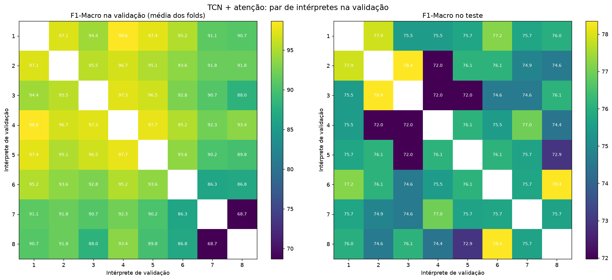
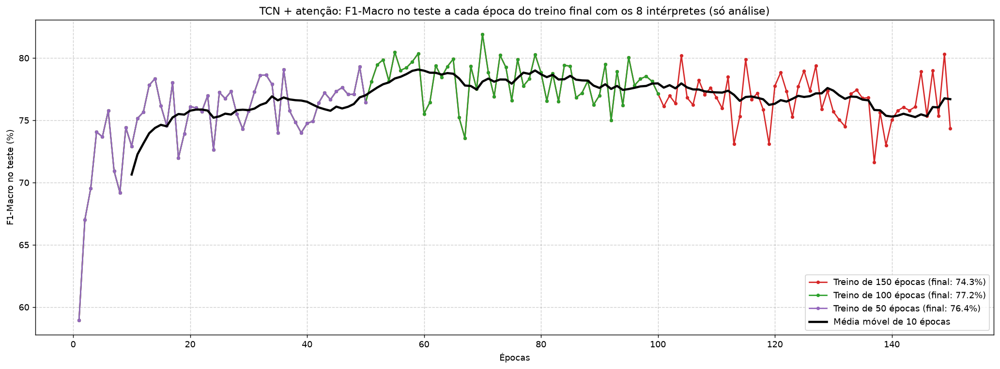

# Protocolo de Validação e Treino Final

Este documento explica como o `pipeline.py` separa os dados de treino, escolhe os hiperparâmetros e treina o modelo final das redes (LSTM, BiLSTM e TCN), e os experimentos que justificam:

- o par de intérpretes **1 e 6** na validação (`INTERPRETES_VALIDACAO`);
- o treino final com **todos os 8 intérpretes** por **100 épocas fixas** (`EPOCAS_TREINO_FINAL`).

Os experimentos foram feitos com o TCN com atenção temporal (`create_tcn_atencao_model`), hiperparâmetros fixos (filters 64, dense 64, dropout 0,4, learning rate 0,0005, batch 32), seed 42 e augmentation de 10× por amostra (11× no total).

## Fluxo atual do pipeline

1. **Coleta:** os dados de treino são lidos do CSV. O grupo de cada amostra é o intérprete (`interprete_do_video`: 5 vídeos por intérprete, 8 intérpretes no treino).
2. **Treino completo:** é feita uma cópia dos dados de treino (sem augmentation) e o augmentation é aplicado **uma única vez** nessa cópia, gerando o treino completo com augmentation. `gerar_amostras_aumentadas(..., retornar_origem=True)` devolve também o índice da amostra original de cada amostra gerada.
3. **Split da validação:** `splitTrainValidation` separa os intérpretes de `INTERPRETES_VALIDACAO` dos dados originais (a validação **nunca** tem augmentation) e retorna os **índices** das amostras de treino.
4. **Treino reduzido:** selecionado pelos índices do split. O reduzido com augmentation é filtrado do treino completo com augmentation pela origem das amostras, sem gerar um segundo augmentation.
5. **GridSearch:** folds `LeaveOneGroupOut` (um intérprete por fold) no treino reduzido, com Early Stopping (paciência 15) pelo F1-Macro na validação. A melhor época de cada fold é registrada só como informação.
6. **Treino final:** o modelo com os melhores hiperparâmetros é retreinado no **treino completo** (os 8 intérpretes), por `EPOCAS_TREINO_FINAL = 100` épocas, sem validação nem Early Stopping.

Os quatro conjuntos sempre existem, e o booleano de augmentation de cada modelo escolhe a versão:

| Conjunto | Amostras | Intérpretes | Uso |
|---|---|---|---|
| Completo sem augmentation | 2397 | 1–8 | treino final (modelos sem augmentation) |
| Completo com augmentation | 26367 | 1–8 | treino final (modelos com augmentation) |
| Reduzido sem augmentation | 1918 | 2, 3, 4, 5, 7, 8 | GridSearch das redes sem augmentation |
| Reduzido com augmentation | 21098 | 2, 3, 4, 5, 7, 8 | GridSearch das redes com augmentation |

Os modelos sklearn (K-Means, RF e XGBoost) não usam validação: o GridSearch e o treino final usam o treino completo.

## Por que LeaveOneGroupOut

O `StratifiedGroupKFold(5)` antigo, com 6 intérpretes no treino reduzido, sempre gerava os mesmos folds `[4] [3] [2] [1] [6, 7]` (a mesma partição nas seeds 42 a 45): quatro folds com um intérprete e um com dois. Com o `LeaveOneGroupOut`, cada fold deixa de fora exatamente um intérprete, o que mede a generalização para um intérprete não visto de forma uniforme.

## Por que treinar o modelo final com todos os intérpretes

Com a validação separada, os dois intérpretes de validação nunca entravam no treino do modelo final, ou seja, o modelo via só 6 dos 8 intérpretes. Como o objetivo é generalizar para intérpretes novos, cada intérprete a mais no treino é variação a mais.

Numa prévia com hiperparâmetros fixos (validação 5 e 8, treino final nos 8 intérpretes pela mediana das melhores épocas dos folds), os resultados no teste foram:

| Modelo | Acurácia no teste | F1-Macro no teste |
|---|---|---|
| TCN com atenção | 76,61% | 75,65% |
| BiLSTM com atenção | 71,35% | 70,17% |
| LSTM com atenção | 69,59% | 66,40% |

O fold sem o intérprete 7 ficou entre 50% e 57% de F1 em todos os modelos: o 7 é o intérprete mais difícil.

## Escolha do par de validação

Foram testados os **28 pares** possíveis dos 8 intérpretes. Para cada par: 6 folds LOGO nos intérpretes restantes, com Early Stopping no par, e o treino final nos 8 intérpretes pela mediana das melhores épocas dos folds.

### O treino final só depende do número de épocas

O treino final é determinístico (mesma seed, mesmos dados). O par de validação só muda **por quantas épocas** o treino final dura. Pares com a mesma mediana geraram exatamente o mesmo modelo (por exemplo, os 5 pares com mediana 20 tiveram 76,09% de F1 no teste), e o F1 de cada par foi idêntico ao F1 na mesma época de um treino único de 50 épocas.

### O F1 na validação não indica o melhor par

- A correlação entre o F1 na validação e o F1 no teste foi de **-0,12**: o F1 de validação mede o quanto o par é fácil, não o quanto o modelo é bom. O par 1+4 tem o maior F1 de validação (98,7%) e 75,5% no teste; o 7+8, o pior (68,7%), tem 75,7% no teste.
- O F1 no teste oscila cerca de **±3 pontos entre épocas vizinhas**. Por isso, a diferença entre o melhor par (78,4%) e o pior (72,0%) na época exata da mediana é em boa parte sorte de onde o treino parou.

### Critério usado: robustez e estabilidade

Para tirar o efeito da oscilação, cada par foi avaliado por:

- **F1 no teste na mediana ±3 épocas:** média do F1 no teste nas épocas vizinhas à mediana, medido na curva do treino de 50 épocas;
- **IQR das melhores épocas:** dispersão das melhores épocas entre os 6 folds (quanto menor, mais estável a escolha da época).

| Par | F1 val | Mediana das épocas | IQR das épocas | F1 teste na mediana | F1 teste na mediana ±3 |
|---|---|---|---|---|---|
| 1+2 | 97,1 | 34 | 18,0 | 77,9 | 77,3 (desvio 1,7) |
| 2+3 | 95,5 | 14 | 17,0 | 78,4 | 76,5 (desvio 1,4) |
| 6+8 | 86,8 | 14 | 16,0 | 78,4 | 76,5 (desvio 1,4) |
| **1+6** | 95,2 | 43 | **7,5** | 77,2 | **76,4 (desvio 1,1)** |
| 1+3 | 94,4 | 28 | 9,0 | 75,5 | 76,3 (desvio 1,1) |
| 4+6 | 95,2 | 28 | 12,8 | 75,5 | 76,3 (desvio 1,1) |
| 1+4 | 98,6 | 28 | 22,0 | 75,5 | 76,3 (desvio 1,1) |
| 4+7 | 92,3 | 23 | 22,2 | 77,0 | 75,9 (desvio 1,4) |
| 2+8 | 91,8 | 16 | 23,2 | 74,6 | 75,8 (desvio 2,2) |
| 3+6 | 92,8 | 16 | 16,8 | 74,6 | 75,8 (desvio 2,2) |
| 3+7 | 90,7 | 16 | 9,8 | 74,6 | 75,8 (desvio 2,2) |
| 7+8 | 68,7 | 12 | 16,5 | 75,7 | 75,8 (desvio 1,7) |
| 5+7 | 90,2 | 12 | 4,8 | 75,7 | 75,8 (desvio 1,7) |
| 2+5 | 95,1 | 20 | 10,2 | 76,1 | 75,5 (desvio 1,9) |
| 2+6 | 93,6 | 20 | 16,0 | 76,1 | 75,5 (desvio 1,9) |
| 3+8 | 88,0 | 20 | 25,5 | 76,1 | 75,5 (desvio 1,9) |
| 5+6 | 93,6 | 20 | 9,8 | 76,1 | 75,5 (desvio 1,9) |
| 4+5 | 97,7 | 20 | 11,5 | 76,1 | 75,5 (desvio 1,9) |
| 1+5 | 97,4 | 22 | 13,0 | 75,7 | 75,5 (desvio 1,5) |
| 6+7 | 86,3 | 22 | 17,8 | 75,7 | 75,5 (desvio 1,5) |
| 1+7 | 91,1 | 22 | 11,8 | 75,7 | 75,5 (desvio 1,5) |
| 2+7 | 91,8 | 38 | 29,8 | 74,9 | 75,3 (desvio 1,6) |
| 3+5 | 96,5 | 18 | 21,5 | 72,0 | 75,2 (desvio 1,8) |
| 2+4 | 96,7 | 18 | 3,2 | 72,0 | 75,2 (desvio 1,8) |
| 3+4 | 97,3 | 18 | 9,2 | 72,0 | 75,2 (desvio 1,8) |
| 1+8 | 90,7 | 21 | 12,0 | 76,0 | 74,8 (desvio 1,8) |
| 5+8 | 89,8 | 10 | 7,8 | 72,9 | 73,7 (desvio 2,7) |
| 4+8 | 93,4 | 9 | 7,8 | 74,4 | 73,4 (desvio 2,4) |

F1 val: média dos folds, no par de validação, na melhor época de cada fold. Valores em %.

### Por que o par 1+6

- **Escolha de época mais estável:** o menor IQR entre os pares do topo (7,5 épocas). Os folds concordam sobre quando parar.
- **Região plana da curva:** a mediana (43 épocas) cai num trecho em que o F1 no teste varia pouco entre épocas vizinhas (desvio de 1,1).
- **F1 médio alto no intérprete deixado de fora de cada fold** (92,2%; só 4+6, com 92,5%, e 6+7, com 94,8%, ficaram acima).

O 1+2 tem a média um pouco maior (77,3%), mas com épocas bem menos consistentes entre os folds (IQR de 18).

O par anterior, **5+8, foi o segundo pior** dos 28: parava o treino cedo demais (mediana de 10 épocas), numa região instável da curva. Os pares com o intérprete 8 paravam, em média, na época 15, contra 28 nos pares com o intérprete 1.

O que fez um par ser bom foi **parar o treino mais tarde**: a correlação com o F1 no teste (na janela ±3) foi de 0,48 para a mediana das épocas e de 0,08 para o F1 de validação. Descontada a oscilação, quase todos os pares ficam entre 75% e 77%: a escolha do par vale de 1,5 a 2 pontos.

## Por que 100 épocas fixas no treino final

Como a validação tendia a parar o treino cedo, o treino final nos 8 intérpretes foi feito também por 50, 100 e 150 épocas fixas. Como o treino é determinístico, as primeiras 50 e 100 épocas do treino de 150 são idênticas aos treinos de 50 e 100.

| Treino final (8 intérpretes) | F1-Macro no teste | Acurácia no teste | Precisão de "acontecer" | Tempo |
|---|---|---|---|---|
| 50 épocas | 76,42% | 78,36% | 0,38 | 6 min |
| **100 épocas** | **77,15%** | **79,24%** | **0,53** | 16 min |
| 150 épocas | 74,33% | 76,32% | 0,45 | 22 min |
| Média dos 28 pares (mediana dos folds) | 75,43% | — | — | — |

F1-Macro no teste por faixa de épocas:

| Épocas | Média | Desvio | Mínimo–máximo |
|---|---|---|---|
| 11–25 | 75,8 | 1,8 | 72,0–78,4 |
| 26–50 | 76,6 | 1,5 | 74,0–79,3 |
| 51–75 | 78,5 | 1,9 | 73,6–81,9 |
| 76–100 | 78,0 | 1,3 | 75,0–80,3 |
| 101–125 | 77,0 | 1,7 | 73,1–80,2 |
| 126–150 | 76,2 | 1,9 | 71,6–80,3 |

- O melhor trecho fica entre **50 e 100 épocas** (média de 78–78,5%), uns 2 pontos acima de onde a validação por pares fazia o treino parar (10 a 43 épocas).
- Depois de 100 épocas o F1 cai aos poucos (de cerca de 78% para 76%), enquanto a loss de treino quase não muda (0,008): sobreajuste leve.
- O trecho de 76 a 100 épocas é o mais estável (desvio de 1,3). Por isso, `EPOCAS_TREINO_FINAL = 100`.
- A oscilação de ±2 a 3 pontos entre épocas vizinhas continua em qualquer duração. O pico de 81,9% na época 70 é sorte e não deve ser reportado.

Com o número de épocas fixo, a validação passa a servir só para escolher os hiperparâmetros no GridSearch. As melhores épocas dos folds ficam registradas em `outputs/results_<modelo>.txt`, apenas como informação.

### Cuidados

- O número de épocas foi escolhido olhando a curva do **teste**. Isso deve ser apresentado como uma análise, e não como um ajuste independente do teste. Para defender as 100 épocas sem usar o teste, o mesmo experimento teria que ser repetido nos folds LOGO.
- As 100 épocas foram definidas com o TCN com atenção. O LSTM e o BiLSTM podem ter o ponto ideal em outra faixa: vale conferir as curvas de acurácia e loss do treino final deles.
